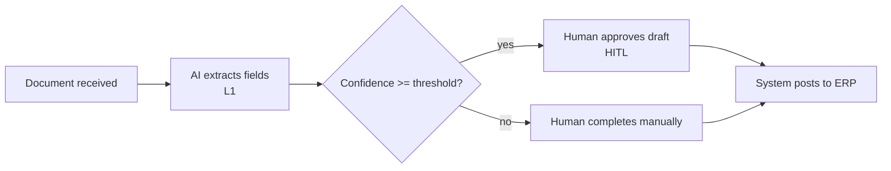

# Process map — {{id}} {{name}}

## As-is steps
<!-- Numbered list of today's steps, who does them, and where time or errors occur. -->
1.

## To-be steps
<!-- One row per step. Actor: AI | human | system. Autonomy: L0-L3 for AI steps (framework/reference/autonomy-levels.md), n/a for human/system. Never exceed usecase.yaml autonomy_target. HITL action: what the human does at this step, or "none". -->
| Step | Actor | Autonomy | HITL action |
|---|---|---|---|

## Flowchart
<!-- Mermaid flowchart of the to-be process. Mark HITL points clearly. Example below; replace it. -->

## Exceptions and escalations
<!-- What can go wrong at each step, who it goes to, and within what time. -->
