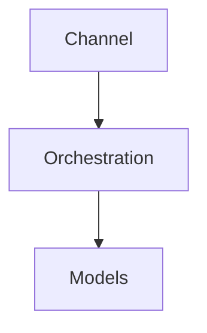

# Component map — {{id}} {{name}}

## Pattern chosen and why
<!-- Format: "Pattern: <id from solution-patterns.md>". Then why, and "Runner-up: <id> — why it lost". -->
Pattern:

## Layers
<!-- All 11 layers from framework/reference/component-architecture.md, in order. Needed: needed | not needed. Technology must be listed in tech-stack.md (or "—" if not needed). Reuse: reuse | extend | new | —. -->
| Layer | Needed | Technology | Reuse | Owner |
|---|---|---|---|---|
| Channel / UI | | | | |
| Orchestration | | | | |
| Models | | | | |
| Knowledge and retrieval | | | | |
| Tools and integrations | | | | |
| Memory and state | | | | |
| HITL workflow | | | | |
| Guardrails | | | | |
| Identity and access | | | | |
| Observability and evaluation | | | | |
| Hosting and environments | | | | |

## Component diagram

