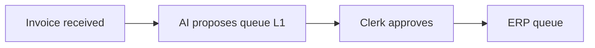

# Process map — UC-001 Invoice triage assistant

## As-is steps
1. Clerk opens invoice from mailbox and reads it.
2. Clerk keys fields and picks a queue.

## To-be steps
| Step | Actor | Autonomy | HITL action |
|---|---|---|---|
| Receive invoice | system | n/a | none |
| Extract fields and propose queue | AI | L2 | Clerk approves or edits |
| Post to ERP queue | | n/a | none |

## Flowchart

## Exceptions and escalations
Low-confidence extraction goes to the supervisor queue within 1 business day.
